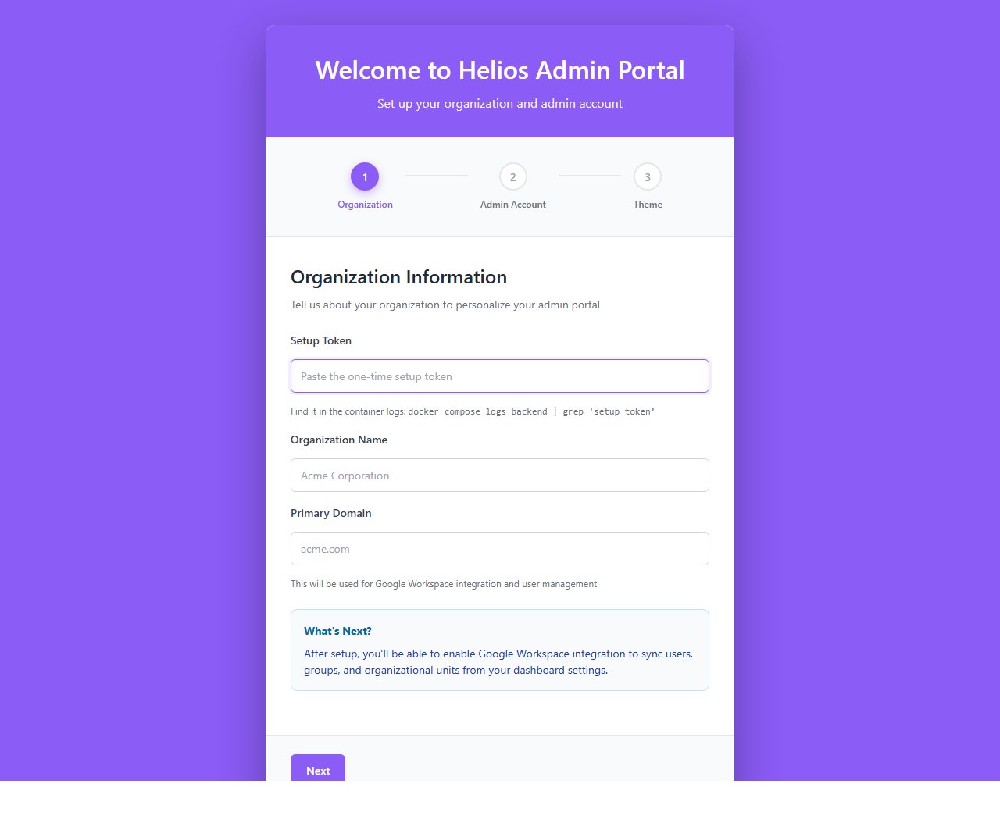
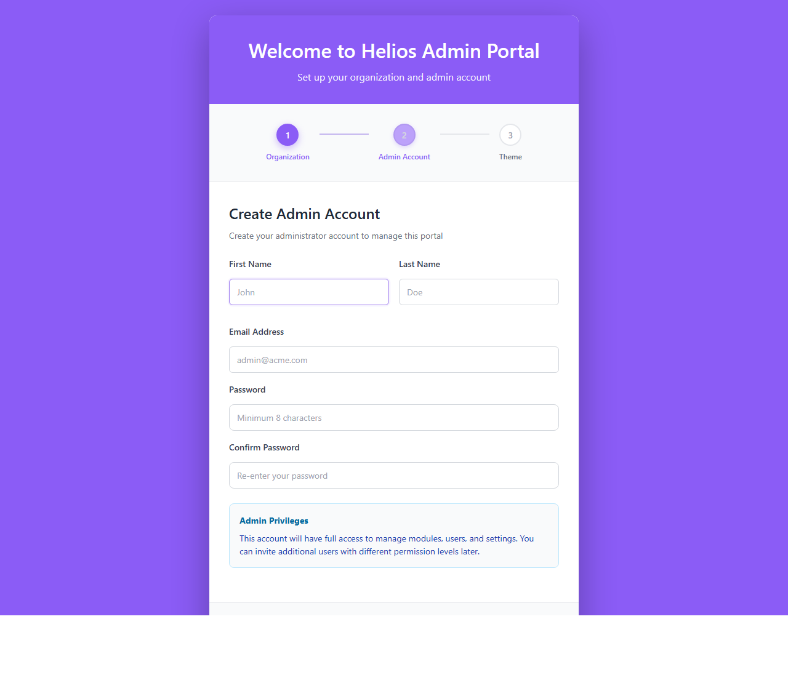
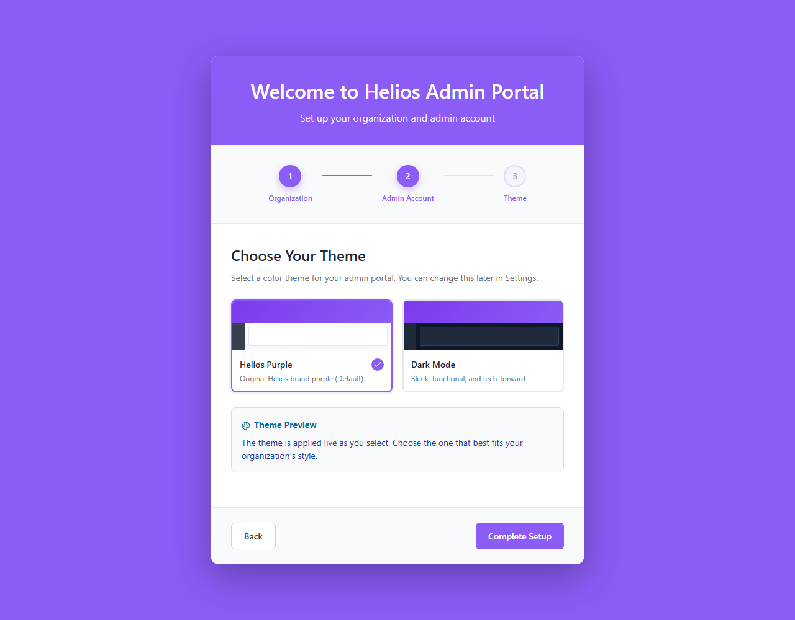

# Installing Helios, step by step

This is the whole path from an empty server to a working install with Google
Workspace connected. Every step here was followed on a fresh server and checked
against the screen. As a rough guide allow half an hour, most of it on the
Google side.

You need:

- A Linux server with Docker and the Compose plugin, and `git`.
- A Google Workspace where you are a super admin.
- If people will reach Helios from other machines: the address they will use.
  See [domain-and-https.md](domain-and-https.md) and decide this first.

## 1. Get the code

```bash
git clone https://github.com/obilabs/helios.git
cd helios
```

## 2. Create the settings file

```bash
cp .env.example .env
```

## 3. Set the six required secrets

Helios will not start until all six are set. Generate a separate value for each
one:

```bash
openssl rand -hex 32
```

Open `.env` and replace the value of each of these:

| Setting | What it protects |
|---|---|
| `DB_PASSWORD` | The database |
| `JWT_SECRET` | Sign-in tokens |
| `ENCRYPTION_KEY` | The stored Google service-account key |
| `EMAIL_ENCRYPTION_KEY` | Stored mail credentials |
| `S3_ACCESS_KEY` | The built-in file store (a shorter value is fine: `openssl rand -hex 12`) |
| `S3_SECRET_KEY` | The built-in file store |

Keep a copy of `ENCRYPTION_KEY` and `EMAIL_ENCRYPTION_KEY` somewhere safe.
Without them a database backup cannot be read.

## 4. Set the address

Skip this step only if you will use Helios from the server itself at
`http://localhost`.

In `.env`, set `PUBLIC_URL` to exactly what people will type in the browser.
The cases, with the other settings each one needs, are in
[domain-and-https.md](domain-and-https.md).

## 5. Start Helios

```bash
docker compose up -d --build
```

The first start builds the images and takes several minutes. Check that
everything is up:

```bash
docker compose ps
```

All six containers should be listed, and `helios_backend` should say `healthy`.

## 6. Read the one-time setup token

The first-run screen asks for a token that only someone with access to the
server can read:

```bash
docker compose logs backend | grep -i 'setup token'
```

Copy the token from that line. It stops working once setup is complete.

## 7. First-run setup: three screens

Open the address from step 4 (or `http://localhost`) in a browser.

### Screen 1: Organization



1. **Setup Token:** paste the token from step 6.
2. **Organization Name:** the name shown at the top of every page.
3. **Primary Domain:** your organization's main email domain, for example
   `example.com`. This is a label for your organization. The Google Workspace
   domain is asked for separately in step 9, and the two may differ.
4. Press **Next**.

### Screen 2: Admin Account



1. **First Name** and **Last Name.**
2. **Email Address:** the address you will sign in with.
3. **Password** and **Confirm Password:** at least 8 characters. This account
   has full control of Helios, so use a long one from a password manager.
4. Press **Next**.

### Screen 3: Theme



1. Choose **Helios Purple** or **Dark Mode.** You can change it later in
   Settings.
2. Press **Complete Setup**.

You land on the Home page, signed in. Until Google is connected, Home shows a
"Connect Google Workspace" card.

## 8. Add a second administrator (recommended)

One administrator is a single point of failure. An administrator cannot be
created in one step: you create an ordinary account, then grant it
administrator access. This is deliberate.

**Create the account**

1. In the left menu, click **Users**.
2. Click **Add User**, then **Quick Add**.
3. Fill in **First Name**, **Last Name** and **Work Email**.
4. Leave **Access Level** on **User**. Choosing Admin here is refused.
5. Under **Password Setup**, choose **Set password now** and enter a password
   twice, or choose **Send password setup link via email** if outgoing mail is
   configured.
6. Press **Create User**.

**Grant administrator access**

1. In the left menu, click **Settings**.
2. Open the **Roles & Admins** tab.
3. Click **+ Add Administrator**.
4. Choose the account under **Select a user to promote to administrator**.
5. Press **Promote to Administrator**.

The account now appears in the Administrators list. Ask its owner to sign in
and change the password you set.

## 9. Connect Google Workspace: four screens

First create a service account in Google Cloud and authorize it in the Google
Admin console. That part happens in Google, not in Helios:
[GOOGLE-WORKSPACE-SETUP-GUIDE.md](GOOGLE-WORKSPACE-SETUP-GUIDE.md), steps 1 to 3.
You finish it holding one JSON key file.

Then, in Helios:

1. In the left menu, click **Settings**. The **Google Workspace** tab is shown
   first.
2. On the Google Workspace card, click **Enable**. A window titled **Google
   Workspace Setup** opens.

### Screen 1: Upload Service Account

1. Click **Click to upload JSON key file** and choose the key file.
2. The screen shows the file name and the service account's address. Check the
   address is the one you created.
3. Press **Next**.

### Screen 2: Configure Domain

1. **Google Workspace Domain:** your Workspace's primary domain. The box may
   arrive filled in with the domain of your own sign-in address; replace it if
   that is not your Workspace domain.
2. **Admin Email Address:** the address of a Google Workspace super admin.
   Helios acts as this person when it calls Google.
3. If you have not authorized the scopes yet, the **Authorize API scopes**
   section on this screen has the list and a pre-filled link to the right page
   of the Google Admin console. Authorize all of them: with fewer, some
   features fail without saying why.
4. Press **Next**.

### Screen 3: Test Connection

1. Press **Test Connection**.
2. Wait for **Connection Verified!** with your domain, the service account and
   the admin email. If it fails, the usual causes are a wrong domain, an admin address that is not a super admin,
   or scopes not yet authorized (Google can take a few minutes to apply them).
3. Press **Next**.

### Screen 4: Complete Setup

1. Check the summary: domain, admin email, service account, project.
2. Press **Complete Setup**.

Helios says the module is enabled and starts the first sync. Within a minute or
two your Google users appear under **Users**, and **Groups** is added to the
left menu.

## 10. Check it worked

- **Users** lists the people in your Workspace.
- **Audit log** shows your setup, the sign-ins and the Google connection, each
  with the address it came from. If that address starts with `172.` or `10.`
  and you have your own proxy in front, see `TRUST_PROXY` in
  [domain-and-https.md](domain-and-https.md).
- Refresh the page: you should stay signed in.

## Upgrading

```bash
git pull
docker compose up -d --build
docker compose restart nginx
```

Read the upgrade notes first: [UPGRADING.md](../UPGRADING.md).

## Removing an install

This deletes the database, uploaded files and the stored Google key. There is
no undo. Take a backup first if you might want the data.

```bash
docker compose down -v
```

`-v` is what removes the data; `docker compose down` on its own stops Helios
and keeps everything. Afterwards delete the folder, and in the Google Admin
console remove the service account's domain-wide delegation so the key can no
longer be used.
